# WEEK 2

## Pratikum layout sederhana
1. Hapus Expanded pada baris nama, lalu amati peringatan overflow atau perilaku layout-nya; kembalikan setelah itu.

    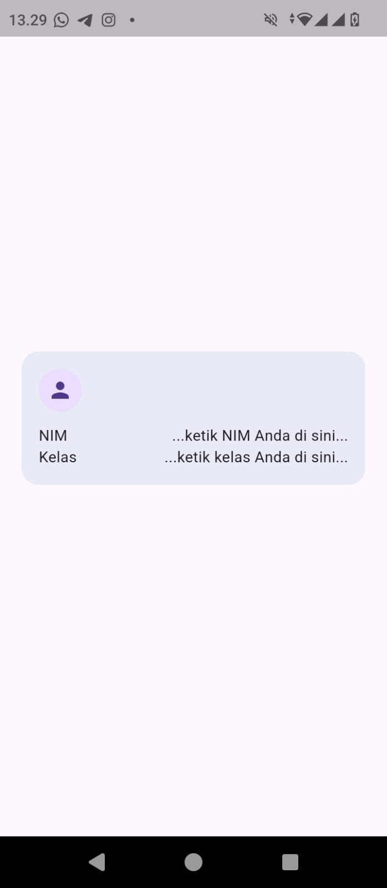

2. Ganti mainAxisSize: MainAxisSize.min menjadi nilai default dan amati perubahan tinggi kartu.

    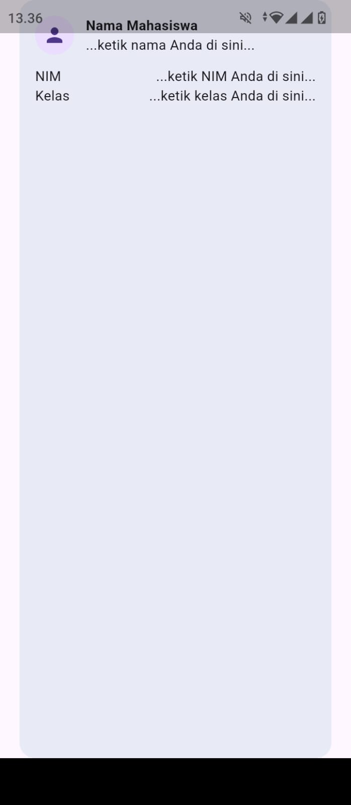

3. Tambahkan satu baris data (misal Email) menggunakan pola Row + Expanded yang sama.

    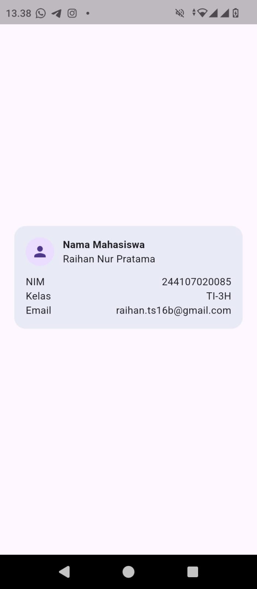

## Pratikum Dashboard Responsif

1. Ubah breakpoint dari 700 menjadi nilai lain dan amati perubahan jumlah kolom.

    

2. Ubah themeMode menjadi ThemeMode.dark, lalu kembalikan ke ThemeMode.system.

    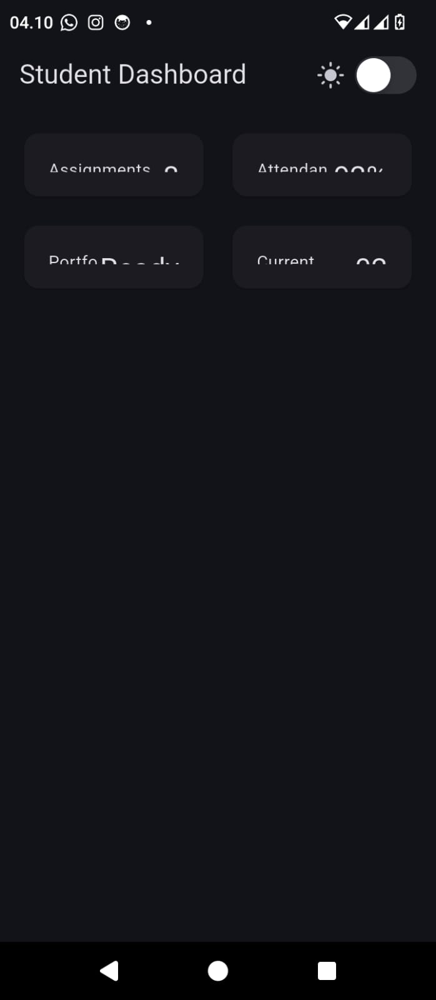

disini auto dark mode karena device saya dark mode

3. Uji aplikasi dengan ukuran layar emulator yang berbeda.

- Ipad

    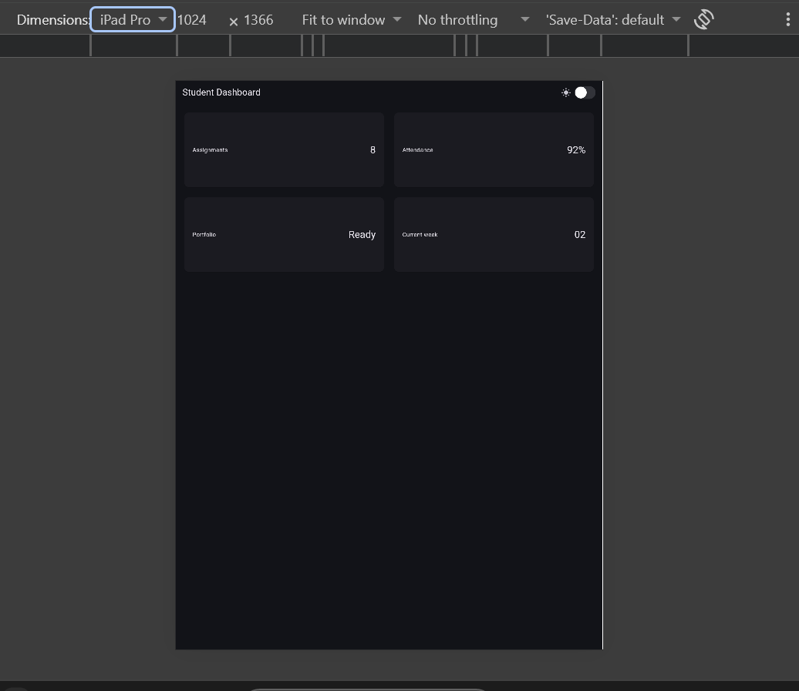

- Iphone

    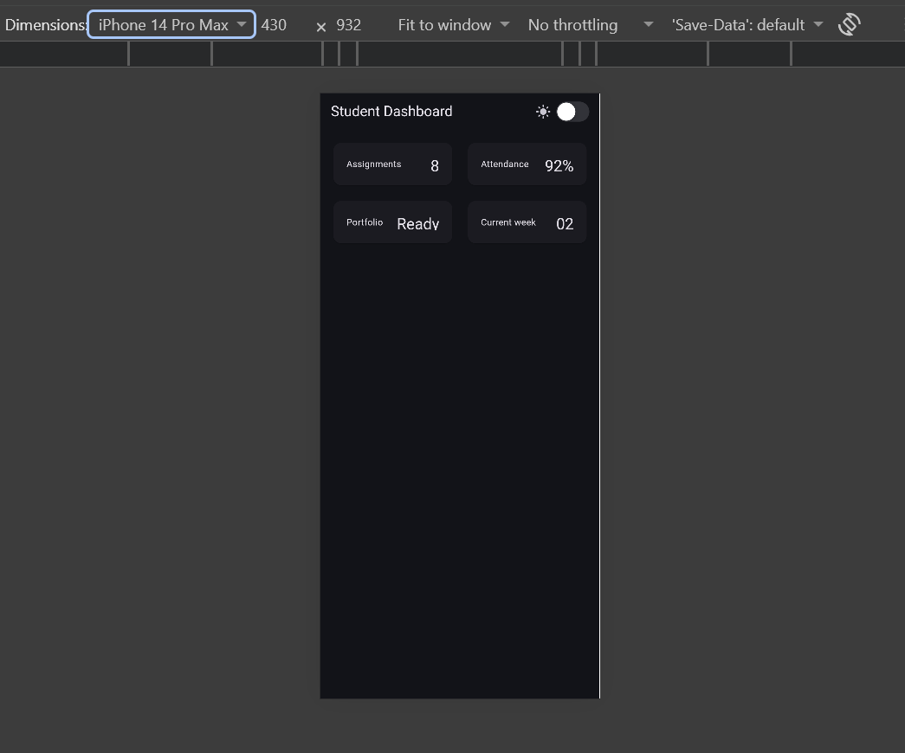

3. Tambahkan Semantics

sudah saya tambahkan dan dalam aplikasi ini semanticsnya ada di:

- Judul dashboard dikenali sebagai heading.
- Switch dikenali sebagai kontrol “Dark mode” dengan status aktif/nonaktif.
- Kartu dashboard dibaca sebagai informasi lengkap, misalnya “Assignments: 8”.
- Ikon dekoratif tidak dibacakan karena tidak menambah informasi.

## Tugas

### Tugas Utama

    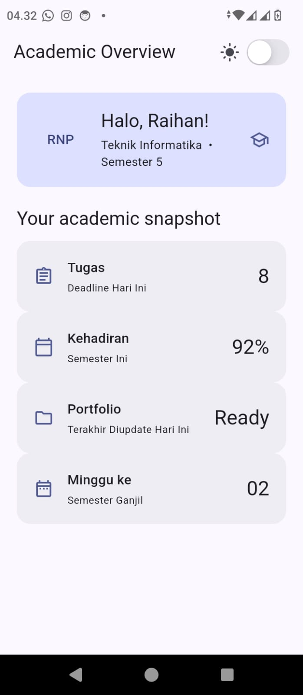

### Ceklis
- Flutter Analyze

    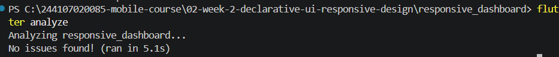

- Flutter Test

    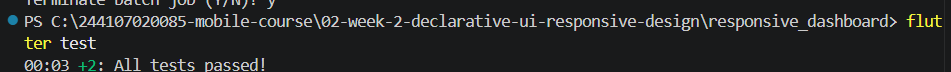

- aplikasi dapat dijalankan di ukuran layar sempit dan lebar
Ipad

    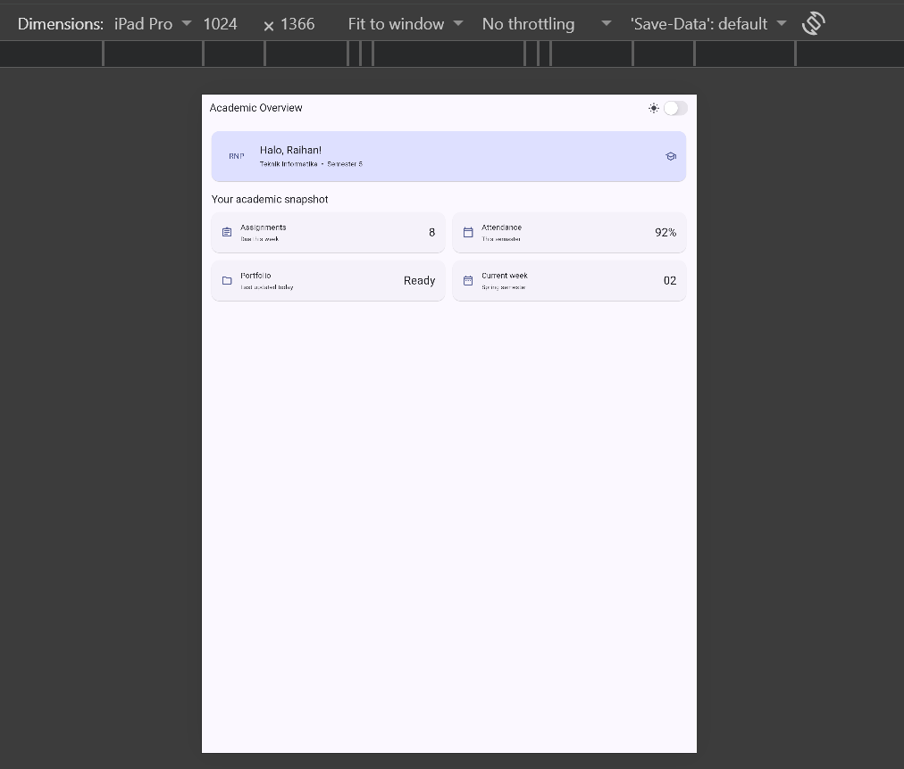

Iphone SE

    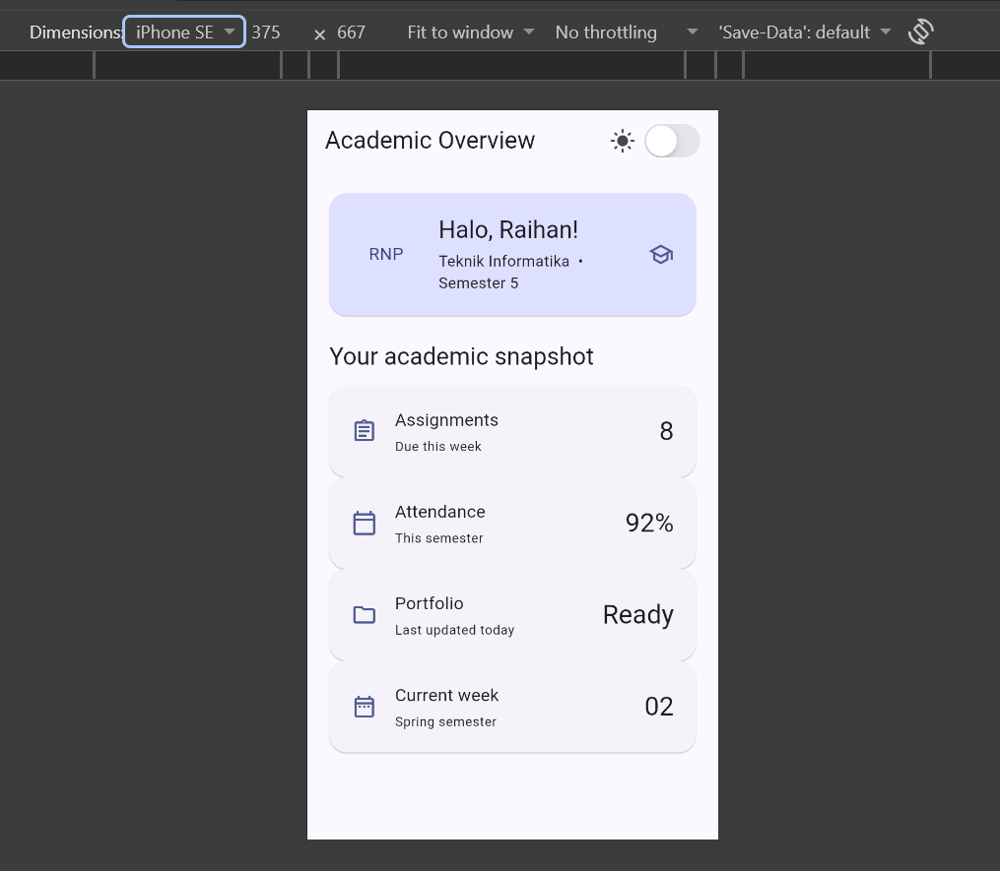

- Dark mode memiliki kontras dan teks yang terbaca.

    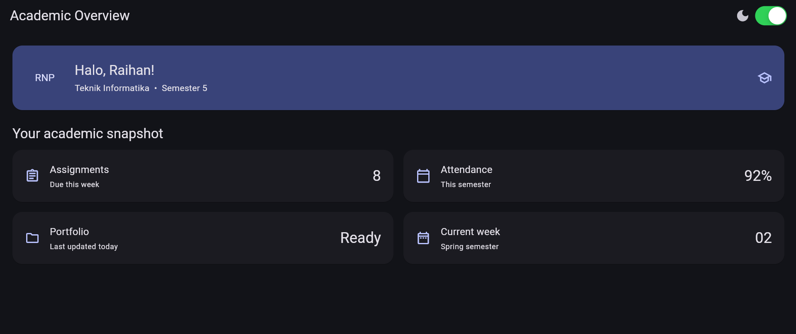

