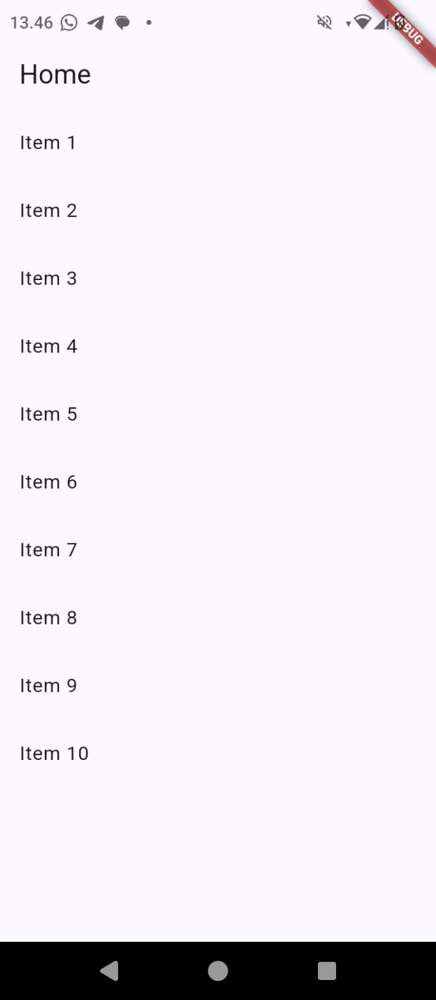
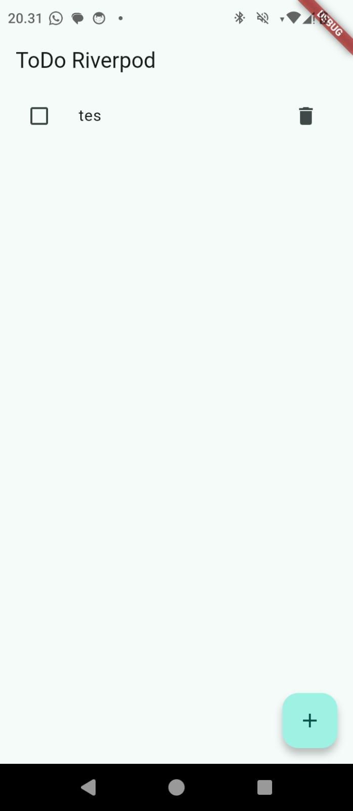

## Pratikum 1

    
    

## Pratikum 2

    

## Pratikum 3

    
    

## Ai challenge

    

    

## Tugas

    
    

## Refleksi

1. Kapan setState masih cukup, dan kapan state harus naik ke Riverpod?
- setState cukup untuk state yang hanya digunakan satu widget, sedangkan Riverpod cocok untuk state yang digunakan banyak widget atau halaman.

2. Apa perbedaan context.go dan context.push, dan kapan masing-masing tepat digunakan?
- context.go digunakan untuk berpindah route, sedangkan context.push digunakan untuk menambahkan halaman baru ke navigation stack.

3. Bagaimana AsyncValue mencegah bug dibanding tiga boolean terpisah?
- AsyncValue lebih aman karena state hanya memiliki kondisi loading, data, atau error, sehingga mencegah kombinasi boolean yang tidak konsisten.