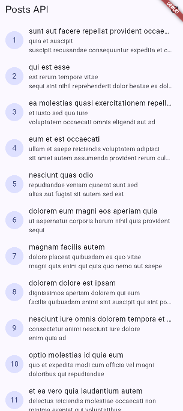

## Pratikum 2
1. Internet

2. Tanpa internet

3. base url salah

## Ai challenge
### Ai verification checklist
1. UI tidak memanggil Dio secara langsung, melainkan melalui Riverpod provider dan CommentRepository.
2. Comment.fromJson sudah aman terhadap field yang hilang, bernilai null, maupun memiliki tipe data yang salah karena menggunakan nilai default.
3. Semua kategori error Dio yang relevan sudah dipetakan ke pesan pengguna, termasuk timeout, connection error, status 404, dan status 500.
4. baseUrl serta seluruh konfigurasi timeout sudah dipusatkan di api_client.dart, sehingga tidak tersebar di setiap method repository.
6. Test sudah mencakup field yang hilang, field bernilai null, dan tipe data yang salah. Analyzer berhasil tanpa error dan tiga test komentar berhasil dijalankan.

## Referensi
1. UI dilarang memanggil Dio langsung agar tampilan tidak bergantung pada detail jaringan, endpoint, timeout, dan parsing JSON. Jika aturan ini dilanggar, kode menjadi sulit diuji dan dirawat, logika jaringan tersebar di banyak widget, serta perubahan API dapat memaksa banyak bagian UI ikut diubah.
2. Pagination client-side cukup ketika jumlah data kecil dan seluruh data memang wajar diambil sekaligus, misalnya daftar komentar untuk satu post. Pagination server dengan _page dan _limit lebih tepat ketika data sangat banyak, respons harus cepat, penggunaan memori perlu dibatasi, atau server menyediakan data yang terus berubah.
3. Exception dari repository berubah menjadi AsyncError karena method build() pada AsyncNotifier mengembalikan Future, dan Riverpod otomatis menangkap exception atau Future yang gagal lalu menyimpannya dalam AsyncValue.error. Widget cukup membaca state melalui when() atau memeriksa hasError, tanpa menulis try/catch berulang.
4. try/catch eksplisit tetap dibutuhkan ketika aplikasi harus melakukan tindakan khusus setelah gagal, seperti menampilkan fallback, mengubah state secara manual saat refresh, mencatat log, melakukan retry tertentu, menerjemahkan atau membungkus exception, maupun menjalankan proses lanjutan yang tidak boleh berhenti ketika satu operasi gagal.