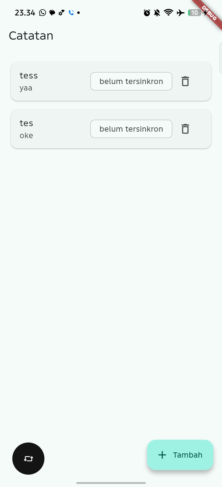
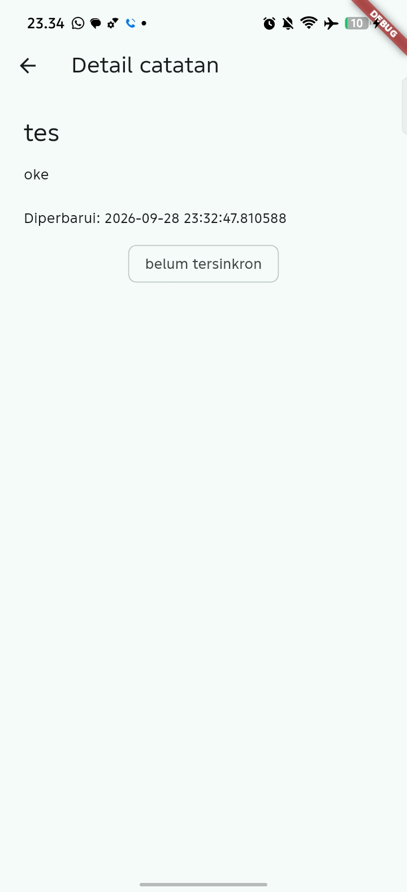
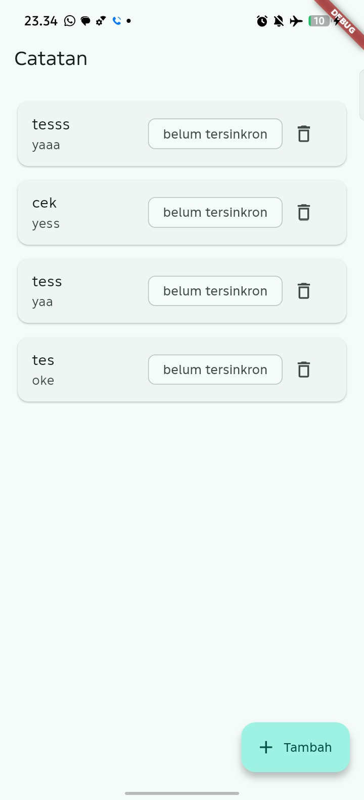
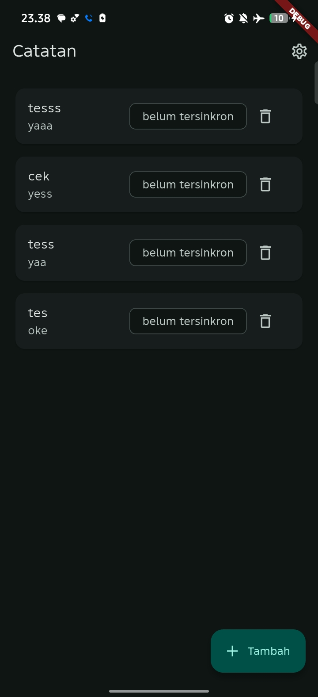
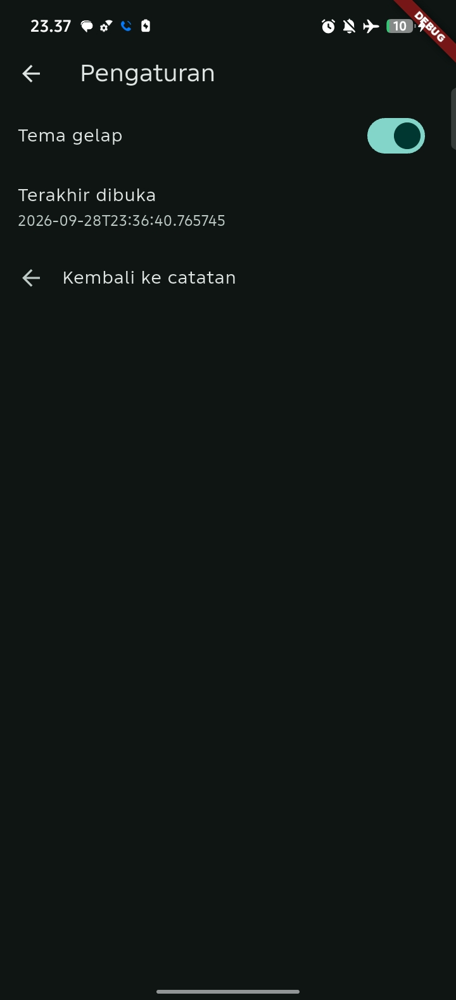

## AI Challenge

1. AI tidak menempatkan daftar catatan di SharedPreferences. SharedPreferences hanya digunakan untuk preferensi sederhana seperti tema gelap, karena menyimpan koleksi catatan di sana akan rapuh dan sulit dicari, diubah, atau dimigrasikan.
2. Skema catatan sebaiknya mendukung antrean sinkronisasi melalui kolom seperti dirty dan updated_at. Dengan begitu, aplikasi dapat mengetahui catatan mana yang belum tersinkronisasi dan kapan terakhir catatan tersebut diubah. CRUD polos tanpa kedua kolom tersebut belum cukup untuk kebutuhan offline-first.

3. Klaim “real-time” hanya benar jika implementasinya benar-benar menggunakan stream, misalnya watch() pada Drift atau stream manual dari SQLite. Jika aplikasi hanya memanggil fetchNotes() setelah operasi CRUD, maka belum dapat disebut reactive real-time.

4. Estimasi boilerplate Drift sebelumnya belum sepenuhnya terverifikasi karena proyek belum menjalankan flutter pub add drift drift_flutter beserta konfigurasi generator dan migrasi skema. Jadi, Drift memang lebih type-safe dan reactive, tetapi membutuhkan setup awal lebih banyak daripada sqflite.

5. Keputusan final saya adalah menggunakan SharedPreferences untuk preferensi tema dan sqflite untuk catatan pada proyek ini. Alasannya, SharedPreferences sudah sesuai untuk data key-value kecil, sedangkan sqflite sudah tersedia dan cukup untuk menyimpan lebih dari 1000 catatan dengan query, index, dirty flag, updated_at, dan transaksi. Drift lebih unggul untuk aplikasi yang membutuhkan stream reactive dan type-safety tinggi, tetapi belum diperlukan jika kompleksitas proyek masih sederhana.

## Refactoring

    

    

    

## Mini Assignment

    

    

